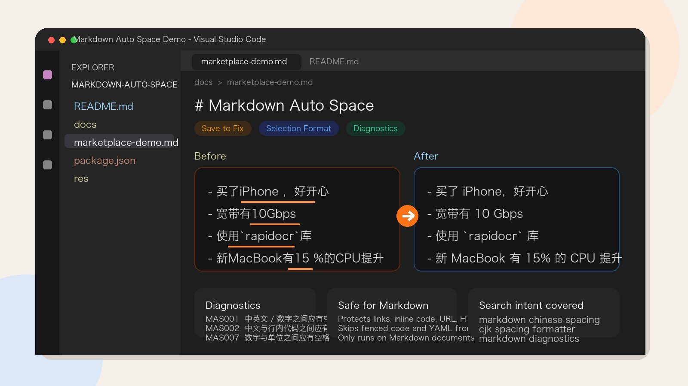

<div align="center">
  <picture>
    <source media="(prefers-color-scheme: dark)" srcset="https://raw.githubusercontent.com/SWHL/markdown-auto-space/refs/heads/main/res/logo-lockup-white.png"  width="60%" height="60%">
    <source media="(prefers-color-scheme: light)" srcset="https://raw.githubusercontent.com/SWHL/markdown-auto-space/refs/heads/main/res/logo-lockup.png"  width="60%" height="60%">
    
  </picture>
</div>

# Markdown Auto Space

Format Chinese-English spacing in Markdown for VS Code.

> 保存时自动修正 Markdown 中的中英混排空格，支持格式化全文，并用波浪线提示不符合规则的位置。

[VS Code Marketplace](https://marketplace.visualstudio.com/items?itemName=SWHL.markdown-auto-space)



## Why install it

如果你经常写中文技术文档、README、博客或知识库，Markdown 里最容易反复手改的就是这些细节：

- `中文English` -> `中文 English`
- ``使用`rapidocr`库`` -> ``使用 `rapidocr` 库``
- `网速10Gbps` -> `网速 10 Gbps`
- `15 %的提升` -> `15% 的提升`
- `买了iPhone ，好开心` -> `买了 iPhone，好开心`

这个扩展把这些排版修正放进 VS Code 的日常编辑流里，不需要再手动全局替换。

## What it does

- 只处理 **Markdown** 文件，不会误改代码文件
- 支持 **手动保存时自动修正**
- 支持 **Format Document**，也可在手动保存时自动格式化全文
- 支持 **诊断提示（squiggles）**，像 markdownlint 一样直接标出问题位置
- 支持 **9 条可单独开关的规则（MAS001–MAS009）**
- 支持 `default`、`conservative`、`strict`、`custom` 四种规则预设
- 支持按 glob 排除生成文档、CHANGELOG 或特定目录
- 支持 markdownlint 风格的局部忽略指令，可按规则忽略块或下一行
- 使用最小范围编辑，只提交实际发生变化的文本区间
- 支持 **VS Code Desktop** 和 **VS Code for the Web**（`vscode.dev`、`github.dev`）

## Rules covered

扩展当前覆盖的规则包括：

| 方向 | 规则码 | 示例 |
|------|--------|------|
| 中英文 / 数字边界加空格 | MAS001 | `中文English` -> `中文 English` |
| 中文与行内代码之间加空格 | MAS002 | ``使用`rapidocr`库`` -> ``使用 `rapidocr` 库`` |
| 中文与链接 / URL 之间加空格 | MAS003 | `查看[文档](url)` -> `查看 [文档](url)` |
| 英文 / 数字之间的顿号改为逗号加空格 | MAS004 | `Python、Java` -> `Python, Java` |
| 斜杠与中文之间加空格 | MAS005 | `前端/后端` -> `前端 / 后端` |
| 链接文本 `[]` 内中英混排加空格 | MAS006 | `[配置import](url)` -> `[配置 import](url)` |
| 数字与单位之间加空格 | MAS007 | `10Gbps` -> `10 Gbps`；`10~20ms` -> `10~20 ms` |
| 百分号 / 度数与数字之间不留空格 | MAS008 | `15 %` -> `15%` |
| 全形标点旁去掉多余空格 | MAS009 | `iPhone ，好` -> `iPhone，好` |

规则说明、更多示例与配置方式见 [docs/RULES.md](./docs/RULES.md)。

## Safe by default

扩展会保护这些内容，避免格式化时误伤：

- Markdown 链接：`[text](url)`
- 图片：``
- 行内代码：反引号包裹内容
- 独立 URL：`https://...`
- 双引号 / 单引号内容
- HTML 标签
- 围栏代码块（反引号 / 波浪线，支持语言标识和不同围栏长度）、缩进代码块、YAML front matter

也就是说，它针对的是 Markdown 文案排版，不是代码美化器。

## Install

最低支持 **VS Code v1.74.0**（桌面版和 Web 版）。安装 VSIX 前，请确认编辑器版本满足此要求。

在 VS Code 扩展市场搜索以下任一关键词即可找到：

- `Markdown Auto Space`
- `markdown chinese spacing`
- `markdown cjk spacing`
- `markdown formatter chinese`

或直接安装：

```bash
code --install-extension SWHL.markdown-auto-space
```

## Usage

### CLI

命令行工具与 VS Code 共用同一套规则和保护逻辑：

```bash
npx markdown-auto-space README.md --write
npx markdown-auto-space "docs/**/*.md" --check
npx markdown-auto-space . --diff
```

输入可以是单文件、目录或 glob。`--write` 写回文件，`--check` 只检查并在存在待修改内容时返回退出码 `1`，`--diff` 输出统一 diff。默认读取当前目录的 `.markdown-auto-space.json` 或 `markdown-auto-space.config.json`，也可通过 `--config path/to/config.json` 指定。配置文件支持 `preset`、`rules`、`units`、`exclude` 和 `fileExtensions`，键名与 VS Code 设置一致。

### 1. Save to fix

默认开启 `markdownAutoSpace.formatOnSave`，你手动保存 Markdown 文件时会自动修正空格问题。

### 支持 MDX, Quarto 和 R Markdown

扩展按文件后缀判断是否处理文档。默认值为 `[".md"]`；需要处理 `.txt` 或其他 Markdown 类文件时，在设置中追加后缀：

```json
{
  "markdownAutoSpace.fileExtensions": [".md", ".txt", ".mdx", ".qmd", ".rmd"]
}
```

后缀可带或不带开头的点号，扩展会自动规范化，并忽略文件名后缀的大小写。`.txt` 受支持但不在默认列表中，需要显式加入配置。文件名匹配不依赖 VS Code 的语言模式，因此配置后的 `.mdx` 或 `.txt` 文件即使被识别为纯文本也会参与处理。

格式化 provider、保存事务、诊断、命令菜单、代码操作和局部指令提示均使用这一配置。修改配置后会立即重新注册 provider、更新菜单并刷新已打开文档的诊断；设为 `[]` 可禁用所有后缀。扩展会在 VS Code 启动完成后激活。

MDX 中的 JSX 标签属性、普通 `{...}` 表达式、跨行表达式、字符串、注释、正则以及 `import` / `export` 语句都会被保护；表达式和代码中的中文混排标识符不会被空格规则改写。表达式前后的正文仍会继续格式化。

保存格式化通过 VS Code 的保存事务返回编辑，由编辑器统一应用。扩展不会在保存事件中再次调用 `applyEdit`，因此能更好地与其他 Markdown 格式化插件共存；自动保存和失焦保存不会触发此功能。

### 2. Format document

- 命令面板运行 `Markdown Auto Space: Format Document`
- 也可以从编辑器标题栏或右键菜单运行；右键菜单中的命令位于修改 / 格式化区域，靠近 VS Code 内置的 `Format Document`
- 格式化完成后，状态栏显示实际修改数量；没有变化时仅显示短暂状态提示，不弹出通知

这是扩展专用命令，始终直接应用 Markdown Auto Space 规则，不受标准格式化提供器开关影响。

VS Code 的标准 `Format Document` 是另一条路径。默认不会注册本扩展的格式化 provider，避免与其他 Markdown formatter 争用；将 `markdownAutoSpace.formatProvider.enable` 设为 `true` 后，才会注册标准格式化 provider。关闭设置时会立即释放 provider，因此 VS Code 不会把本扩展当作可用的标准 formatter。设置变更无需重载窗口。

### 3. Preview changes

- 命令面板运行 `Markdown Auto Space: Preview Changes`
- 扩展会打开 VS Code 的 diff 编辑器，展示原文与格式化结果，并在摘要中显示总修改数和各 MAS 规则命中数
- 选择 `Apply Changes` 后才会应用与 `Format Document` 相同的最小范围编辑；选择 `Cancel` 或关闭提示不会修改原文
- 文档无需修改时只显示状态栏提示，不创建空 diff

### 4. See diagnostics before fixing

开启 `markdownAutoSpace.diagnostics.enable` 后，扩展会像 markdownlint 一样用波浪线提示问题，并显示对应规则码：

- `MAS001`: 中英文 / 数字之间应有空格
- `MAS002`: 中文与行内代码之间应有空格
- `MAS003`: 中文与链接 / URL 之间应有空格
- `MAS004`: 英文 / 数字间的顿号应改为逗号加空格
- `MAS005`: 斜杠与中文之间应有空格
- `MAS006`: 超链接 `[]` 内中英文混排时英文左右应有空格
- `MAS007`: 数字与单位之间应有空格
- `MAS008`: 度数、百分号与数字之间不应有空格
- `MAS009`: 全形标点旁不应有空格

启用诊断、切换 `markdownAutoSpace.preset`、切换 `markdownAutoSpace.rules` 中的任一规则，或修改 `markdownAutoSpace.units`、`markdownAutoSpace.exclude`、`markdownAutoSpace.fileExtensions` 后，已打开的已启用文件会立即更新诊断，无需再次编辑或保存。移出后缀列表或命中排除配置的文档会清除诊断。关闭诊断后，问题面板中的提示和编辑器波浪线会立即清空；其他配置变化不会触发全量诊断刷新。

## Configuration

| 配置项 | 默认值 | 说明 |
|------|------|------|
| `markdownAutoSpace.diagnostics.enable` | `true` | 显示规则提示波浪线 |
| `markdownAutoSpace.fileExtensions` | `[".md"]` | 要处理的文件后缀；可加入 `.txt`、`.mdx`、`.qmd`、`.rmd` 等 |
| `markdownAutoSpace.formatOnSave` | `true` | 手动保存 Markdown 时自动修正 |
| `markdownAutoSpace.formatProvider.enable` | `false` | 启用本扩展对 VS Code 标准 `Format Document` 的格式化 provider；扩展专用命令不受影响 |
| `markdownAutoSpace.exclude` | `[]` | 在所有格式化、命令和诊断中排除匹配的文件 |
| `markdownAutoSpace.preset` | `"default"` | 规则预设：`default`、`conservative`、`strict` 或 `custom` |
| `markdownAutoSpace.rules` | 全部开启 | 按规则码单独开关 MAS001–MAS009 |
| `markdownAutoSpace.units` | `{ "additional": [], "exclude": [] }` | 自定义 MAS007 单位；`additional` 追加默认单位，`exclude` 排除单位 |

例如关闭部分规则：

```json
{
  "markdownAutoSpace.rules": {
    "MAS005": false,
    "MAS009": false
  }
}
```

规则预设会先提供一组规则基线：`default` 和 `strict` 开启全部规则，`conservative` 只开启 MAS001–MAS003 与 MAS007，`custom` 保持逐条配置的现有行为。若同时设置 `markdownAutoSpace.preset` 和 `markdownAutoSpace.rules`，`rules` 中明确写出的规则优先，未写出的规则沿用 preset（`custom` 中未写出的规则默认为开启）。例如：

```json
{
  "markdownAutoSpace.preset": "conservative",
  "markdownAutoSpace.rules": {
    "MAS005": true,
    "MAS001": false
  }
}
```

上例会在保守预设基础上重新开启 MAS005，并关闭 MAS001；切换 preset 后诊断和格式化结果会立即更新。

例如追加领域单位，配置大小写策略，或排除会与产品型号冲突的默认单位：

```json
{
  "markdownAutoSpace.units": {
    "additional": ["rpm", "kWh", "μm"],
    "exclude": ["V"],
    "caseSensitive": true,
    "protectedModels": ["Python3", "X100"]
  }
}
```

非法、空白或重复单位会被忽略；单位会安全转义后用于匹配。`caseSensitive` 默认为 `true`，设为 `false` 时 `gbps` 与 `Gbps` 等 ASCII 字母大小写等价。`protectedModels` 中的产品型号会整体保护。自定义单位、大小写策略和型号名单同时用于正文、超链接文本的格式化和 MAS007 诊断。`additional` 与 `include` 中的单位会合并；也可只使用 `include` 作为 `additional` 的别名。

单位配置暂不拆分为独立文件：选项规模较小，并且 VS Code 设置能直接提供用户、工作区和语言级覆盖及即时诊断刷新；未来若需要大规模领域词典，再评估外部词典方案。

例如排除所有工作区根目录下的 `CHANGELOG.md` 和 `generated` 目录：

```json
{
  "markdownAutoSpace.exclude": [
    "**/CHANGELOG.md",
    "**/generated/**"
  ]
}
```

排除项使用 VS Code glob 语法，并同时作用于手动保存格式化、`Markdown Auto Space: Format Document` 命令、启用后的标准 Format Document provider 和诊断。工作区内的路径相对文件所属的工作区根目录匹配；多根工作区会分别以各自根目录为基准，因此同一模式对每个根一致生效。工作区外的文档按完整文档路径匹配。VS Code Web 的虚拟工作区 URI 同样以所属工作区根为基准；不属于任何工作区的非文件 URI 通常只会在其 URI 路径匹配模式时被排除。

## Behavior details

- 仅在 `markdownAutoSpace.fileExtensions` 配置的文件后缀中生效，默认是 `.md`；`.txt` 需要显式配置
- `markdownAutoSpace.exclude` 命中的文档不会被格式化，也不会产生诊断
- 自动保存、失焦保存不会触发 `formatOnSave`
- 保存时只返回实际变化位置的编辑，不会全文替换文档；未变化文本、光标 / 选区和换行格式会尽量保持稳定
- 支持 LF, CRLF 以及同一文档中的混合换行格式，不会为了格式化空格改写换行符
- 无需修改时不会产生空编辑，避免文档脏状态抖动；命令反馈使用状态栏短提示和输出日志
- 文档开头的 YAML front matter 不参与格式化和诊断；正文中的水平分隔线不会影响后续内容处理
- 未闭合的 YAML front matter 采用保守策略，后续内容不会被修改或诊断
- 围栏代码块支持反引号和波浪线，起始围栏为 3 个或更多字符；只有相同字符且长度不短于起始围栏的结束标记才会闭合代码块
- 未闭合的围栏代码块采用保守策略，后续内容不会被修改或诊断
- 支持 `<!-- markdown-auto-space-disable MAS005 -->` / `enable` 按规则忽略块，以及独占一行的 `disable-next-line` 忽略下一行；不写规则码时忽略全部规则
- `disable-next-line` 忽略的是注释后紧接着的一行；当前不支持 `disable-line`，也不支持把指令写在正文行尾。未知规则码不会关闭任何规则，未闭合 `disable` 会保守地忽略到文档末尾。代码围栏和 YAML front matter 内的同名注释不会改变局部忽略状态
- 忽略指令支持较短的 `mas-disable`、`mas-enable` 和 `mas-disable-next-line` 写法；在指令中输入规则码时可获得 VS Code 补全，悬停规则码可查看说明、示例和完整文档链接
- 输入 `<!-- mas-` 或 `<!-- markdown-auto-space-` 时会自动提示可用指令，选择后可继续获得规则码提示
- 补全和悬停仅在完整的独占一行忽略注释中生效，普通正文或其他 HTML 注释中的 `MASxxx` 不会触发规则提示
- Markdown 结构兼容性：引用块、嵌套列表和表格单元格中的正文会正常处理；引用式链接 `[文档][id]` 与自动链接 `<https://example.com>` 会保护语法并处理链接边界，引用定义行保持不变
- 支持跨行 HTML/HTML 注释、常见 JSX/MDX 块以及 `{{template}}` / `${expression}` 表达式保护；这些结构内部不会被格式化
- 转义 Markdown 标点（例如 `\``、`\[`）按字面文本处理；未闭合的行内代码、链接、引号和模板表达式采用保守策略，避免破坏原文
- 复杂 Markdown 语法当前使用轻量状态扫描和局部保护，不引入 Markdown AST 运行时依赖，以保持 Web 扩展包体积和单行处理性能

## Rule docs

更完整的规则说明、输入输出示例和与《中文文案排版指北》的对应关系见 [docs/RULES.md](./docs/RULES.md)。

## Changelog

正式发布使用 Git tag 作为唯一版本来源。推送 `vX.Y.Z` tag 后，Release CI 只在临时构建工作区中将 `package.json` 版本设置为 `X.Y.Z` 并生成对应版本的 VSIX，不会修改或提交仓库中的 `package.json`、`CHANGELOG.md`。因此仓库里的版本号只是开发基线，最终安装包版本以 tag 为准；本节维护面向用户的发版说明。

| 版本 | 摘要 |
|------|------|
| **未发布** | 重构保存格式化流程；保存时通过 `waitUntil` 返回编辑并由 VS Code 保存事务应用；全文、选区和命令格式化改用最小范围编辑；保留 LF / CRLF 换行并补充多行、多处变化、无变化及混合换行测试；诊断开关、规则或 MAS007 单位配置变化后立即更新已打开文档的诊断 |
| **0.0.9** | 修复保存格式化后残留诊断；统一命令入口与英文提示；扩展 Markdown 语法兼容性并完善配置变化后的诊断刷新 |
| **0.0.8** | 重写 Marketplace 文案与关键词；新增更接近真实 VS Code 的横向宣传图；优化商店展示与 VSIX 体积 |
| **0.0.7** | 优化格式化稳定性与选区处理；新增自动发版工作流；精简 CI 与发布链路 |
| **0.0.6** | 新增 MAS007–MAS009：数字与单位、度 / 百分号、全形标点旁空格规则 |
| 0.0.5 | 新增 MAS006：链接文本 `[]` 内中英混排空格 |

完整历史见 [CHANGELOG.md](./CHANGELOG.md)。

## Development

### 性能基准

项目包含固定的 10 万行 Markdown 大文件基准，记录格式化耗时、编辑数量、堆内存增量，并覆盖 MDX/大文档保护扫描。运行 `pnpm test:benchmark` 查看指标并验证回归阈值；诊断 debounce 的 300 ms 契约也在该套件中锁定。详细阈值和解释见 [docs/PERFORMANCE.md](./docs/PERFORMANCE.md)。

```bash
pnpm lint
pnpm typecheck
pnpm test
pnpm build
pnpm package:vsix
```

`pnpm package:vsix` 会生成带当前 `package.json` 版本号的 `.vsix` 文件（例如 `markdown-auto-space-0.0.9.vsix`）。在 VS Code 扩展面板中选择“从 VSIX 安装”，安装后执行 `Developer: Reload Window`，确保测试的是最新构建。

针对保存格式化流程，可以在 Extension Development Host 中验证：打开 Markdown 文件，输入 `中文English`、多行混排文本以及带 CRLF 的内容后手动保存。预期只修改实际需要加空格或删空格的位置，代码块内容和换行符保持不变；启用其他 Markdown 格式化插件时，也不会由本扩展全文覆盖文档。

围栏代码块相关测试可单独运行：

```bash
pnpm exec vitest run -t "围栏"
```

## References

- [中文文案排版指北](https://github.com/sparanoid/chinese-copywriting-guidelines)
- [markdownlint](https://github.com/DavidAnson/markdownlint)
- [autocorrect](https://github.com/huacnlee/autocorrect)
- [vscode-auto-space](https://github.com/Talljack/vscode-auto-space)

## License

[MIT](./LICENSE) © [SWHL](https://github.com/SWHL)
